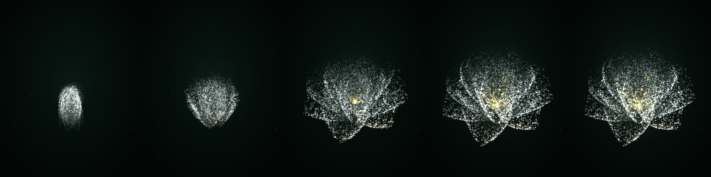

# 白山茶 · 手控绽放

**在线预览 → https://zyr123-star.github.io/camellia-bloom/**
（HTTPS，摄像头可用；桌面 Chrome / Edge 体验最佳）

一握手，花收成一枚苞；一张开手掌，白山茶便一层一层散开，跟着手走，指尖还能轻轻拨动花瓣。

Three.js 粒子 + MediaPipe Hands 21 关键点 + 自定义 GLSL，纯原生 ES Module，无需构建。



> 上图由 `tools/preview.mjs` 离线软件渲染，与网页端使用同一套几何、光照与配色。

---

## 快速开始

摄像头 API 只在**安全上下文**下可用（`https` 或 `localhost`），所以不能直接双击 `index.html`。

```bash
cd camellia-bloom
node serve.mjs            # → http://localhost:5173
```

或用任意静态服务器：

```bash
python -m http.server 5173
npx vite                  # 也可以，项目本身就是原生 ESM
```

打开页面 → 点「开启摄像头」→ 举起手，掌心朝向镜头。

> 第一次会从 jsDelivr 拉 three.js 与 MediaPipe（约 6 MB，有缓存）。
> 如果网络拉不到手部模型，页面会**自动进入演示模式**：花朵照常呼吸，按住鼠标/屏幕即可模拟「张开手掌」，不会白屏。

---

## 分享给别人看

摄像头只在**安全上下文**下可用（`https://` 或 `http://localhost`）。这一条决定了分享方式：

### 方式一：同一局域网（最快，但没有摄像头）

```bash
node serve.mjs 5173 lan      # 会打印 http://<局域网IP>:5173
```

对方在浏览器打开即可，但因为是 `http + 局域网 IP`，浏览器会**禁用摄像头**，只能看到演示模式（呼吸、按住模拟张开）。适合"先看看效果"。

### 方式二：临时公网 HTTPS（推荐，一行命令，不用注册）

```bash
npx cloudflared tunnel --url http://localhost:5173
# → https://xxxx-xxxx.trycloudflare.com    （https，摄像头正常）
```

同理还有：

```bash
npx localtunnel --port 5173
ngrok http 5173              # 需要先 ngrok config add-authtoken
```

拿到的是临时链接，关掉命令就失效；适合发给朋友当场看。

### 方式三：部署成静态站（长期可用的链接）

项目是纯静态 ESM，**不需要构建**，整个目录直接部署：

```bash
npx vercel --prod            # 或
npx netlify deploy --prod --dir=.
```

也可以推到 GitHub 用 Pages / Cloudflare Pages 托管。注意两点：

1. 不要用 `file://` 打开，必须走 HTTP 服务
2. 对方机器要能访问 jsDelivr（three.js 与 MediaPipe 的资源和模型都从那取）

---

## 它怎么工作

### 1. 手势 → `tension`（手掌张开度 0~1）

MediaPipe 给出 21 个归一化关键点。对五指各算一个「伸展度」，再用两个**互补**指标，避免单一指标的误判：

**① 伸展比**（尺度无关、旋转无关）

```
reach_f = |指尖 - 手腕| / |指根 - 手腕|
```

握拳约 1.0~1.25，完全张开约 2.0~2.3。归一化：

```
reachScore = clamp((reach_f - 1.18) / (2.05 - 1.18), 0, 1)
```

**② 指节伸直度**（防止手朝镜头倾斜时，透视把距离压扁）

```
θ_f      = ∠(指根, 近节指骨, 指尖)          // 0~π，伸直≈π
straight = clamp((θ_f/π - 0.33) / 0.33, 0, 1)
```

**合成**（拇指权重低一些，因为它更容易抖）：

```
ext_f   = 0.62 · reachScore_f + 0.38 · straight_f
tension = Σ(w_f · ext_f) / Σ w_f
w = { 拇指 0.70, 食指 1.00, 中指 1.00, 无名指 0.95, 小指 0.85 }
```

实测（合成手型扫描）：张开 **0.95** / 半握 **0.64** / 握拳 **0.06**，随蜷曲单调下降。

**平滑**：指数趋近，开掌 τ=85 ms、握拳 τ=55 ms（收拢更快，手感更「脆」）。

### 2. `tension` → 绽放度 `spread`

```js
const targetSpread = smoothstep(0.32, 0.66, tension);   // <0.32 → 0（花苞）  >0.66 → 1（盛放）
spread += (targetSpread - spread) * 0.1;                // 你要求的缓动
```

第二行在 60fps 下**严格等于** `* 0.1`；为了高刷屏不加速，代码里做了帧率补偿：

```js
const k = 1 - Math.pow(1 - 0.1, dt * 60);   // 60fps 时 k === 0.1
spread += (targetSpread - spread) * k;
```

### 3. 花朵：一片花瓣的参数曲面，求值两次

每片花瓣是一个参数曲面 `P(s, a)`：

- `s ∈ [0,1]` 基部 → 尖端，`a ∈ [-1,1]` 横向（`a=±1` 是左右边缘）
- 半宽轮廓 `W(t) = Wmax · t^0.55 · (1 − t⁴)^0.5`
  - `t→0` 时收窄 → 白山茶的**楔形瓣爪**
  - 到 `t≈0.75` 才收顶，`t=0.95` 时仍有约一半宽度 → **宽圆的瓣顶**
  - 这一条是造型关键：如果轮廓在尖端直接收敛到 0（`sin` 那类曲线），
    粒子云的瓣尖会变成一个个尖角，看起来像百合或碎冰；保持宽圆收口，
    才会出现山茶那种圆钝、彼此交叠的花瓣轮廓

同一个曲面用两套姿态参数各求值一次：

| 参数 | 含义 | 花苞 | 盛放 |
|---|---|---|---|
| `beta` | 花瓣与花轴夹角 | 3°~9°（贴轴） | 40°~74°（展开） |
| `rBase` | 基部离轴距离 | 大（包成球） | 小（从花心散开） |
| `cup` | 横向杯曲 | 强（两侧包裹） | 中（浅碗） |
| `curl` | 纵向卷曲 | 正（尖端内扣） | 正（瓣尖微微起翘） |
| `twist` | 沿长度的螺旋扭转 | 有（层层包裹） | 无 |

于是得到 `aBud / aBloom` 两套顶点，中间过程全部交给 GPU。

三轮共 18 片花瓣（7 外 / 6 中 / 5 内），每片还有 ±5% 的长度、宽度和 ±10° 的倾角扰动，避免「数学完美」的塑料感。另外两个提升「山茶感」的细节：

- **花瓣中脊高光**：`1 + 0.14·e^(−a²·3.4)`，克制的一道蜡质反光（太强会变成条纹渐变）
- **瓣缘密度渐隐**：`0.62 + 0.38·smoothstep(1.02, 0.66, |a|)`，让花瓣边界是柔和的过渡而不是一条几何线

### 配色：刻意的「平涂」三色

整个画面只有三块颜色，并且尽量少让它们互相渗透：

| 色块 | 做法 |
|---|---|
| **纯白花瓣** | 花瓣色全部压到接近纯白（`petalTip` 从偏蓝的 `0.884,0.936,1.0` 提到 `0.972,0.988,1.0`），平光照明 `0.72 + 0.40·diff + 0.20·rim`，不再做强烈明暗渐变 |
| **饱和金蕊** | 花药 `1.0, 0.70, 0.13`；花丝粒子少而细（否则一堆叠就冲成米黄），花心那圈「核光」压到暗金薄雾，不参与糊白 |
| **近黑墨绿底** | 背景渐变收到 `0.028,0.080,0.060 → 0.006,0.018,0.014`，并关掉花后面的绿色光晕 |

最后用一个全局亮度 `uGain`（默认 0.8）整体压一遍：让花瓣在密集处刚好压成平白，而不是过曝成一片灰白。

### 4. 顶点着色器里完成插值与动画

```glsl
float sd = smoothstep(aDelay, aDelay + 0.62, uSpread);   // 按花瓣错峰绽放
vec3 pos = mix(aBud, aBloom, sd);
vec3 nrm = normalize(mix(aNBud, aNBloom, sd));

// 呼吸微颤 + 指尖排斥
pos += sin(vec3(...)) * (0.0035 + 0.009 * sd);
vec3  d = pos - uTip;
pos += d / (length(d) + 1e-4) * exp(-dot(d,d) * 30.0) * uTipPower * 0.045;

// 两面受光的假光照 + 边缘透光 + 景深衰减
float diff = abs(dot(wn, L));
float shade = 0.34 + 0.82 * diff + 0.55 * pow(1.0 - abs(wn.z), 2.0);
```

整个过程 **CPU 每帧只更新 3 个 uniform**（spread / time / 指尖），零顶点计算。

- 花瓣按轮次错峰绽放：外轮先开（delay 0），内轮最后（0.18）——像真花一样由外向内
- 加色混合（AdditiveBlending）+ 软核精灵，叠出通透的发光花瓣
- 画布**必须不透明**：透明画布会被浏览器按 premultiplied alpha 合成，加色粒子叠在页面上会出现黑边。所以背景是一层 WebGL 全屏渐变（`src/backdrop.js`），颜色与 CSS 的 `--ink` 完全对齐

### 5. 跟随与交互

大画面**不显示摄像头**——白花需要干净的深色背景才立得住，手的实时画面只放在右下角小窗里。因此跟随不需要像素级对齐，只把手的归一化位置映射成画面中的**有限位移**（横向 ±30%、纵向 ±24%）：

- 手怎么动，花就跟着漂；幅度收住，不会飞出构图
- 手的归一化尺寸（离镜头远近）→ 花朵缩放
- 食指指尖作为排斥源，靠近时花瓣会被「拨开」
- 拖拽可旋转花朵，带阻尼回弹
- 摄像头不可用 → 自动降级为演示模式（呼吸 + 按住模拟张开）

### 6. 手部捕捉小窗（看清手到底有没有被识别）

右下角一块独立取景器，这是唯一显示摄像头画面的地方：

- 实时镜像画面 + 21 点骨架 + 张开度圆环
- 顶部状态：`跟踪中` / `等待手部` / `无模型`；检测到手时指示灯变绿并呼吸
- 底部是实时的 tension 数值与进度条
- 没检测到手时，画面里有一条上下扫描的线，表示还在找
- 按 `C` 或点顶栏「捕捉」开关小窗；按 `H` 只切换小窗里的骨架

---

## 文件结构

```
camellia-bloom/
├── index.html              入口：importmap 映射 three.js
├── styles.css              墨绿夜色 / 玉白 / 一点金 的界面
├── serve.mjs               零依赖静态服务器（自动打印局域网地址）
├── src/
│   ├── main.js             状态机、tension→spread、跟随、HUD、错误降级
│   ├── flowerGeometry.js   ★ 纯数学：花瓣曲面、双姿态、法向、颜色（不依赖 three）
│   ├── flower.js           three.js 层：Points + ShaderMaterial + 光晕 + 浮尘
│   ├── handTracker.js      MediaPipe 封装 + tension 公式 + 预热探测
│   ├── backdrop.js         背景：全屏墨绿渐变（WebGL，颜色对齐 --ink）
│   ├── handPreview.js      右下角手部捕捉小窗（取景框 + 骨架 + 张力）
│   └── skeleton.js         骨架绘制（小窗用）
└── tools/
    ├── check.mjs           自检：tension 回归 / 阈值 / 几何 / 着色器一致性
    ├── preview.mjs         离线光栅器：没浏览器也能把粒子渲染成 PNG
    └── sweep.mjs           参数扫描，出对比图
```

`flowerGeometry.js` 是纯数学模块，**同一份数据**既喂给 WebGL，也能被 `tools/preview.mjs` 在 Node 里软件渲染成图 —— 所以造型可以脱离浏览器迭代。

---

## 调参

集中在两个地方：

**`src/main.js` 顶部 `CFG`**

| 参数 | 默认 | 说明 |
|---|---|---|
| `CLOSED_AT` | 0.32 | 低于此值完全合拢 |
| `OPEN_AT` | 0.66 | 高于此值完全绽放 |
| `SPREAD_EASE` | 0.1 | 绽放缓动（每帧比例 @60fps） |
| `TENSION_TAU_OPEN/CLOSE` | 0.085 / 0.055 s | 张开 / 收拢的平滑时间常数 |
| `IDLE_SPEED` | 0.42 | 无人时「呼吸」速度 |

**`src/flowerGeometry.js` 的 `WHORLS`**：每轮花瓣的 `petals / beta / L / W / rBase / cup / curl / twist / y0`，花苞与盛放各一套。

URL 参数（调试用）：

```
?spread=0.5        锁定绽放度（0~1），并自动跳过开场页
?demo=1            强制演示模式
?particles=20000   覆盖粒子数
?pitch=0.42        调整俯视角（弧度，默认 0.80 ≈ 46°）
```

快捷键：`H` 骨架 · `C` 手部捕捉小窗 · `空格` 自动演示 · `?` 说明

粒子数默认：桌面 16000 / 移动端 9000。

---

## 自检与离线预览

```bash
node tools/check.mjs      # 39 项：tension 回归、阈值、几何、着色器属性、DOM 契约
node tools/preview.mjs    # 输出 preview-out/*.png（不同绽放度）
node tools/sweep.mjs      # 输出参数对比拼图 sweep.png
```

`preview.mjs` 用与着色器**同构**的投影 / 假光照 / 软核叠加把粒子光栅化，可以在没有显卡的机器上检查造型。

---

## 常见问题

**摄像头打不开**
必须是 `http://localhost` 或 `https`。用 `file://` 打开会被浏览器直接拒绝。

**一直显示「正在加载手部模型」**
`@mediapipe/hands` 的 wasm 与 tflite 模型要从 jsDelivr 拉。网络不通时会自动降级到演示模式（只是没有手势识别，花照常开）。若需要完全离线，可把 `https://cdn.jsdelivr.net/npm/@mediapipe/hands@0.4.1675469240/` 整包镜像到本地，改 `src/handTracker.js` 里的 `MP_BASE`。

**为什么用 legacy `@mediapipe/hands` 而不是 tasks-vision**
legacy 包的 wasm + 模型全部在同一个 npm 包里，一个 CDN 源就能跑通；`tasks-vision` 还要额外从 `storage.googleapis.com` 拉 `.task` 模型，那条线路在部分地区不稳定。整个追踪层是 `HandTracker` 一个类，想换实现只改这一个文件。

**手部识别有点飘**
`handTracker.js` 里 `modelComplexity`（0=lite / 1=full）和 `minTrackingConfidence` 可调；移动端默认 lite。

**手机上很卡**
把 `?particles=6000` 带上，或调低 `renderer.setPixelRatio` 的上限（`src/main.js`）。

---

## 许可

MIT。花朵几何与着色器均为原创实现。
